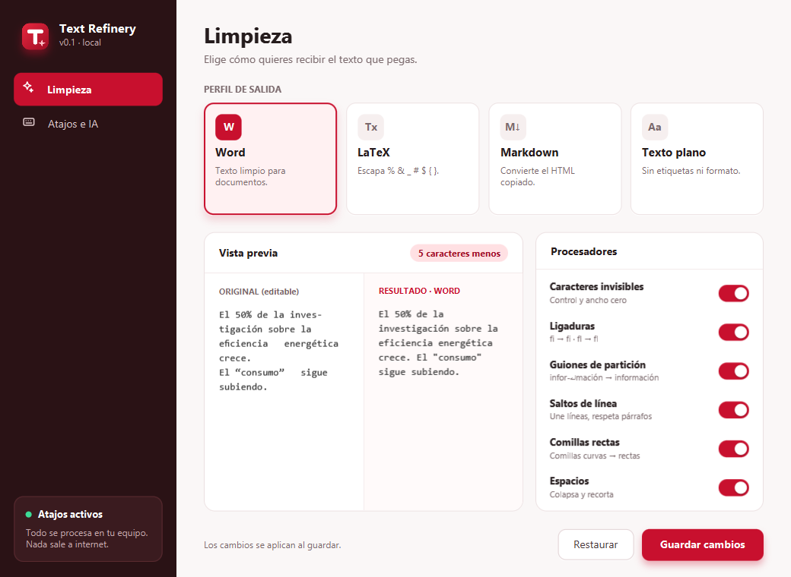
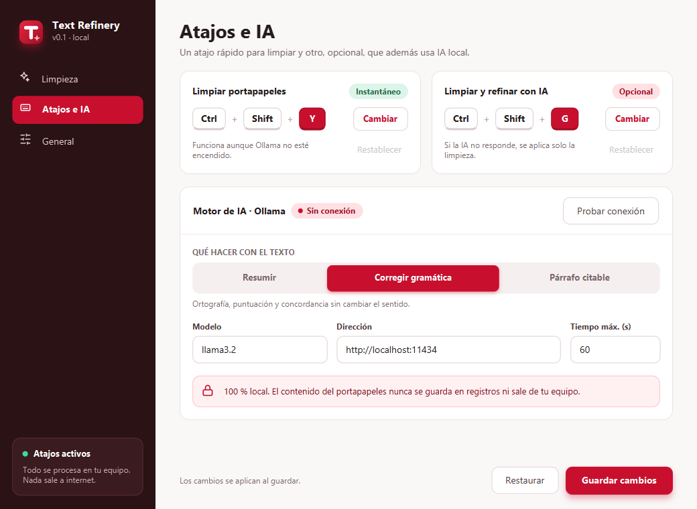
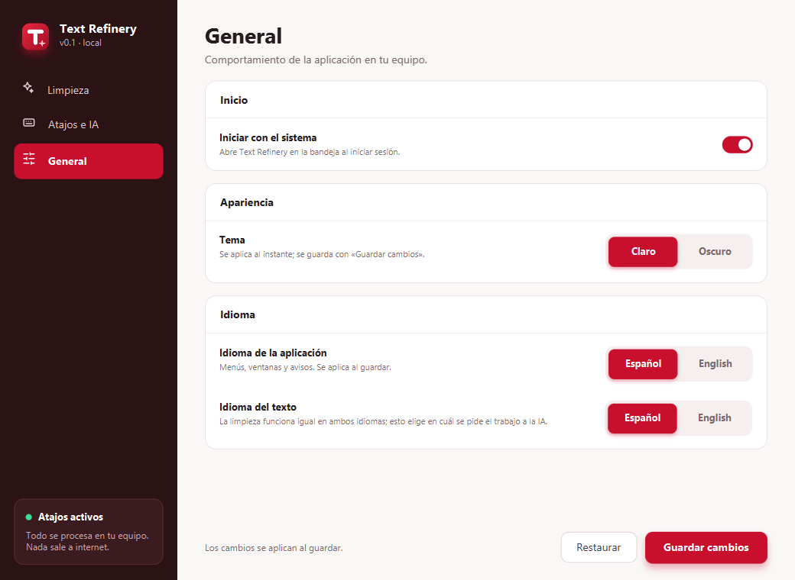
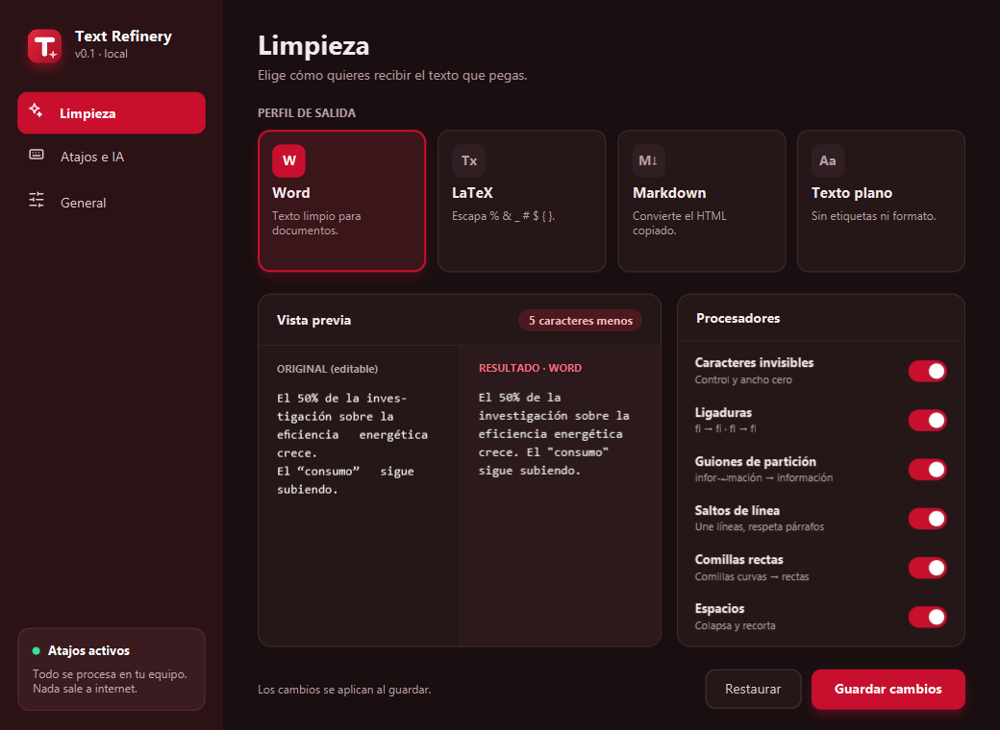
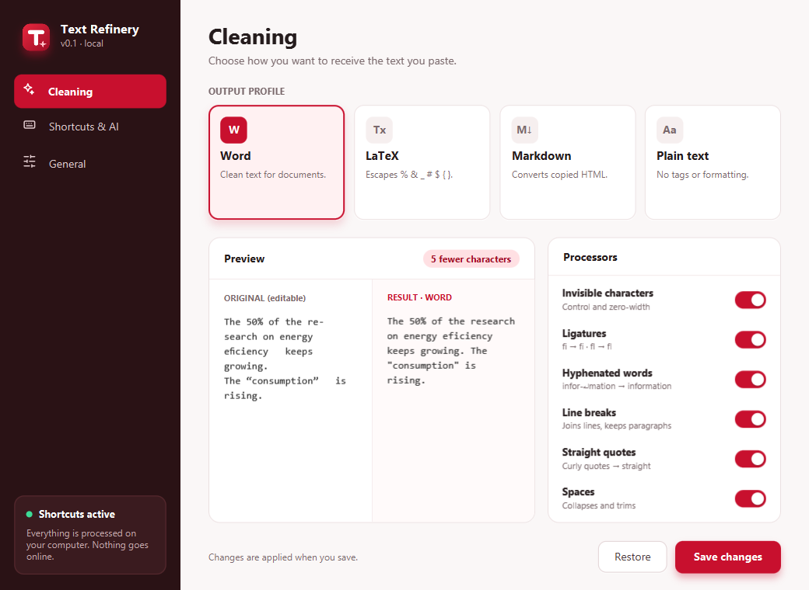
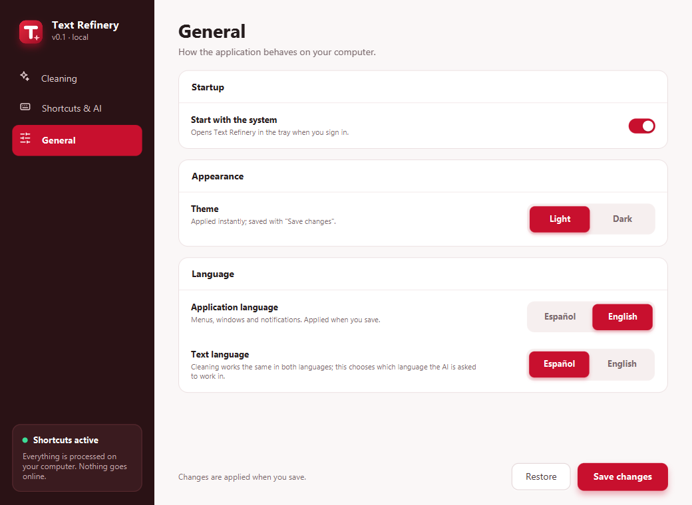

<p align="center"></p>

# Text Refinery Desktop

Aplicación residente en la bandeja del sistema que limpia el texto del portapapeles (saltos de línea
artificiales de PDF, guiones de partición, ligaduras, comillas, espacios) con un atajo global, y
opcionalmente lo refina con IA local (Ollama). Funciona en **Windows, macOS y Linux**.

## Uso

1. Copia texto (Ctrl/Cmd+C).
2. Pulsa **Ctrl+Shift+Y** → el portapapeles queda limpio. Pega donde quieras.
3. **Ctrl+Shift+G** → limpia y además lo envía a Ollama (resumir / corregir / párrafo citable).
   Si Ollama no responde, solo se aplica la limpieza.

¿Te arrepientes? **Restaurar texto original** en el menú de bandeja devuelve lo que habías copiado (solo en memoria; se pierde al cerrar la app).

Perfiles: **Word**, **LaTeX** (escapa `% & _ # $ { } ~ ^ \`), **Markdown** (convierte HTML copiado de la web) y **Texto plano**.
Los atajos, el perfil, el modelo de IA y los procesadores activos se cambian desde *Ajustes…* en el menú de bandeja.

**Cambiar un atajo** (*Ajustes → Atajos e IA*): pulsa **Cambiar**, mantén los modificadores (se ven en vivo) y pulsa una letra, número o
tecla F; **Esc**, un clic fuera o cambiar de ventana cancelan. Mientras grabas, los atajos globales se suspenden para que también
puedas elegir una combinación que ya está en uso, y si repites el de la otra acción te avisa al instante. **Restablecer** vuelve al
atajo predeterminado (`Ctrl+Shift+Y` limpiar, `Ctrl+Shift+G` limpiar con IA); queda desactivado cuando ya es el predeterminado.

## Interfaz

Tema propio en rojo (`#C8102E`) con escala tonal 50–900, barra lateral vino y componentes a medida
(interruptores, teclas, selector segmentado). La vista previa de *Limpieza* ejecuta el pipeline real:
editas el texto de la izquierda y ves el resultado según el perfil y los procesadores activos.
Los atajos se cambian pulsando **Cambiar** y escribiendo la combinación.

Tres páginas: **Limpieza**, **Atajos e IA** y **General** (arranque con el sistema, tema claro/oscuro e idioma de la IA).

| Limpieza | Atajos e IA |
|---|---|
|  |  |
| **General** | **Tema oscuro** |
|  |  |
| **En inglés: Cleaning** | **En inglés: General** |
|  |  |

**Idioma de la aplicación:** menús, ventanas y avisos están en español o inglés (*General → Idioma*). Se aplica al guardar, sin
reiniciar, y al guardar la ventana vuelve a la página principal. Por defecto sigue el idioma del sistema. Es independiente del
*idioma del texto*, que solo decide en qué idioma se pide el trabajo a la IA.

Detalles del diseño y de la paleta en [docs/ui-design.md](docs/ui-design.md).

## IA local (Ollama): cómo probarla y qué esperar

1. Instala [Ollama](https://ollama.com) (`winget install Ollama.Ollama` en Windows) y descarga el modelo: `ollama pull llama3.2` (~2 GB).
2. En *Ajustes → Atajos e IA* pulsa **Probar conexión**: debe decir «Conectado».
   Con **Iniciar Ollama automáticamente** activado (lo está por defecto), si Ollama no está abierto la app lo arranca ella sola al
   usar la IA o al pulsar *Probar conexión* (la primera vez tarda unos segundos más) y lo cierra al salir. Solo cierra el que arrancó
   ella: si ya lo tenías abierto, no lo toca. Solo aplica a una dirección local (`localhost`); si Ollama no está instalado, la app sigue
   limpiando y avisa de que la IA no está disponible. Abrir la ventana de ajustes nunca lo arranca.
3. Copia un texto y pulsa **Ctrl+Shift+G**: se limpia y se refina según el modo elegido (resumir, corregir gramática o párrafo citable).

Para ver cómo responde el modelo sin usar la app (3 modos, tiempo y comprobación automática de que no aparecen cifras que no estén
en el original): `mvn test-compile exec:java -Dexec.classpathScope=test -Dexec.mainClass=com.textrefinery.infrastructure.OllamaLiveCheck -Dexec.args="es"`
(o `en`; opcionalmente un modelo y un archivo de texto).

Resultados medidos con `llama3.2` (3B) en un equipo sin GPU, sobre un párrafo de 92 palabras:

| Modo | Resultado | Tiempo |
|---|---|---|
| Corregir gramática | Corrige todos los errores sin cambiar el sentido | 4–8 s |
| Párrafo citable | Formal y en tercera persona; conserva autores, años y cifras | 18–25 s |
| Resumir | 92 → ~43 palabras; conserva autores y cifras, pero pierde detalle (a veces la conclusión) | 13–21 s |

Notas: los tiempos dependen del equipo (con GPU bajan mucho) y el primero incluye cargar el modelo. Un modelo de 3B resume de forma
correcta pero genérica, sobre todo en inglés; para mejores resúmenes usa un modelo mayor (cámbialo en *Ajustes → Atajos e IA → Modelo*).
Dos decisiones que salieron de esta prueba: el resumen pide una **longitud concreta** (~45 % del original; sin ella el modelo devolvía
casi el mismo texto) y las peticiones usan **temperatura baja** (0,2) y contexto de 8192 tokens (el predeterminado de Ollama recorta
en silencio los textos largos). Si Ollama no responde, la app deja solo la limpieza y avisa.

## Requisitos

- JDK 17 o superior
- Maven 3.9+
- (opcional) [Ollama](https://ollama.com) con un modelo descargado: `ollama pull llama3.2`

## Desarrollo

```bash
mvn test                  # pruebas unitarias + golden files
mvn compile exec:java     # ejecutar la app
mvn package               # genera target/text-refinery-*.jar y target/libs/
```

## Empaquetado (instalador nativo)

Cada sistema empaqueta con su propio JDK; no hay compilación cruzada.

| SO      | Comando                                  | Resultado                           | Requisito extra |
|---------|------------------------------------------|-------------------------------------|-----------------|
| Windows | `scripts\package.ps1`                    | instalador `.exe` (`-Type msi`)     | WiX Toolset 3.x |
| Windows | `scripts\package.ps1 -Type app-image`    | carpeta ejecutable, sin instalar    | —               |
| macOS   | `scripts/package.sh`                     | `.dmg`                              | Xcode CLT       |
| Linux   | `scripts/package.sh`                     | `.deb`                              | `fakeroot`      |

El paquete incluye su propio runtime de Java: quien lo instala no necesita tener Java. Con `-SkipBuild`
(o `SKIP_BUILD=1`) se reutiliza `target/` sin llamar a Maven. El resultado queda en `dist/`.
Verificado en Windows con `app-image`; los instaladores `.exe`/`.msi`, `.dmg` y `.deb` aún no se han probado.

Los iconos (`src/main/resources/icons/app.ico`, `.icns`, `.png`) se generan desde el logo con
`java -cp "target/classes;target/libs/*" scripts/GenerateIcons.java` (en macOS/Linux, `:` en lugar de `;`).

## Notas por plataforma

- **macOS**: la primera vez hay que conceder *Accesibilidad* (Ajustes del Sistema → Privacidad y seguridad) para que el atajo global funcione.
- **Linux**: el atajo global requiere X11 (con Wayland no recibe teclas de otras apps). La bandeja necesita una extensión de AppIndicator en GNOME; si no hay bandeja, las notificaciones van al log.
- **Configuración**: `%APPDATA%\TextRefinery\settings.json`, `~/Library/Application Support/TextRefinery/settings.json` o `~/.config/text-refinery/settings.json`.

## Registro y solución de problemas

La app escribe `app.log` junto a `settings.json` (carpeta de configuración, ver arriba), con fecha y hora, y lo rota
a `app.log.1` al superar 1 MB. Se abre desde el menú de bandeja con **Ver registro**. Sirve cuando la app se abre con
doble clic y no hay consola. Solo contiene eventos, longitudes de texto y tipos de error, nunca el contenido copiado.

| Síntoma | Qué mirar |
|---|---|
| El atajo no hace nada | Ver registro: ¿dice «No se pudo activar el atajo global»? Cambia la combinación en *Ajustes → Atajos e IA* |
| «IA no disponible» | *Atajos e IA → Probar conexión*; ¿está Ollama corriendo y el modelo descargado? |
| No arranca con el sistema | *General → Iniciar con el sistema*; no está disponible al ejecutar desde el código fuente |
| Los avisos o la barra de tareas dicen «OpenJDK» o muestran el icono de Java | Cierra la app anterior y abre la nueva (ver abajo). Si sigue pasando, mira `app.log`: debe decir «Identidad de la app en Windows: registrada» |

### Nombre e icono en Windows («OpenJDK Platform binary»)

Con `java -jar …` el programa que corre es `javaw.exe`, y Windows le atribuye **su** nombre, icono y descripción. La app lo corrige en
tres sitios, y cada uno se comprobó contra Windows (no solo en el código):

| Dónde | Qué hace la app | Cómo se comprobó |
|---|---|---|
| **Avisos** («Texto limpio ✓») | Declara una identidad propia (`SetCurrentProcessExplicitAppUserModelID`, vía JNA) y registra nombre e icono en `HKCU\Software\Classes\AppUserModelId\TextRefinery.App` | El aviso aparece en el Centro de notificaciones **a nombre de `TextRefinery.App`**; sin la identidad, no |
| **Barra de tareas** | La ventana de ajustes lleva el logo como icono propio de Windows | `WM_GETICON` sobre la ventana real: antes «ninguno», ahora «propio» |
| **Administrador de tareas / Inicio** | Solo lo resuelve el paquete (`Text Refinery.exe`) | `FileDescription` del proceso: `OpenJDK Platform binary` frente a `Text Refinery` |

Dos hallazgos que conviene recordar: JavaFX **ignora en silencio** los iconos de ventana que son un `snapshot` dibujado por código (hay
que usar imágenes cargadas desde PNG), y el lanzador de `jpackage` arranca un proceso hijo que aloja la JVM.

La clave del registro la crea la app en cada arranque (sin administrador) y se puede borrar sin consecuencias.
`java -jar` sigue apareciendo como «OpenJDK Platform binary» en el Administrador de tareas: es el nombre del ejecutable de Java; para
verlo como «Text Refinery» ejecuta el paquete (`scripts\package.ps1 -Type app-image`, o el instalador). Para abrir la ventana de
ajustes al arrancar: `Text Refinery.exe --settings`.

## Privacidad

Todo es local. El contenido del portapapeles nunca se registra en logs ni se envía fuera de la máquina (Ollama corre en `localhost`).

## Documentación

- [Arquitectura](docs/architecture.md)
- [Decisiones (ADR)](docs/adr/)
